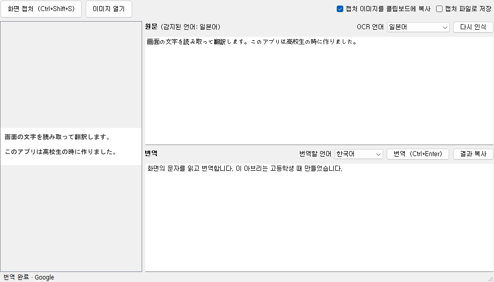

# 캡처 번역기 (Capture Translator)

화면의 원하는 영역을 드래그해서 캡처하면, **OCR로 글자를 읽고 → 언어를 자동 감지해 → 원하는 언어로 번역**해 주는 Windows 데스크톱 앱입니다.
게임, 이미지 속 텍스트, 복사가 막힌 PDF처럼 **텍스트를 복사할 수 없는 화면**을 번역하려고 만들었습니다.

> 2022년 고등학생 때 처음 만든 프로젝트를 2026년에 다시 손봤습니다.
> 처음 작성한 코드는 [`legacy/`](legacy/)에 그대로 남겨 두었습니다(API 키만 제거). 무엇을 왜 바꿨는지는 [아래](#2022--2026-무엇이-바뀌었나)에 정리했습니다.



## 주요 기능

- **드래그 영역 캡처**: 화면이 정지된 상태에서 드래그로 영역 선택 (Esc/우클릭으로 취소, 방향 상관없음)
- **OCR**: Tesseract 기반, 한국어·영어·일본어(가로/세로쓰기) 지원, 인식 전 흑백 변환과 확대로 인식률 개선
- **자동 언어 감지 + 번역**: 8개 언어로 번역, 번역할 언어를 바꾸면 즉시 다시 번역
- **OCR 결과 직접 수정**: 잘못 인식된 글자를 고친 뒤 `Ctrl+Enter`로 다시 번역
- 캡처 이미지를 클립보드에 복사, 파일로 저장(선택), 번역 결과 복사
- 이미지 파일 열기로도 번역 가능
- OCR과 번역은 백그라운드 스레드에서 실행되므로 작업 중에도 창이 멈추지 않음

## 동작 방식

```
[화면 캡처]  ──▶  [전처리]  ──▶  [OCR]  ──▶  [텍스트 정리]  ──▶  [번역]
 SnipOverlay      흑백·확대       Tesseract     줄바꿈 병합,        Google 번역
 (QScreen)        (Pillow)                     CJK 공백 제거        (언어 자동 감지)
```

| 모듈 | 역할 |
| --- | --- |
| [`overlay.py`](capture_translator/overlay.py) | 전체 화면 오버레이에서 드래그로 영역 선택, 고DPI 배율 보정 |
| [`ocr.py`](capture_translator/ocr.py) | Tesseract 경로 탐색, 전처리, OCR 결과 정리(`clean_text`) |
| [`translator.py`](capture_translator/translator.py) | Google 번역 요청, 응답 파싱 |
| [`workers.py`](capture_translator/workers.py) | `QThreadPool` 기반 백그라운드 작업 |
| [`app.py`](capture_translator/app.py) | 메인 윈도우, 전체 흐름 연결 |
| [`ui/main_window.ui`](capture_translator/ui/main_window.ui) | Qt Designer 화면 파일 |

## 설치 및 실행

**요구 사항**: Windows 10/11, Python 3.10 이상, [Tesseract OCR](https://github.com/UB-Mannheim/tesseract/wiki)

1. Tesseract를 설치합니다. 설치할 때 *Additional language data*에서 **Korean, Japanese**를 선택하세요.
2. 프로젝트를 설치하고 실행합니다.

```bash
git clone https://github.com/yoonsik0222/capture-translator.git
cd capture-translator
python -m venv .venv
.venv\Scripts\activate
pip install -r requirements.txt
python run.py
```

### 사용법

1. **화면 캡처** 버튼(또는 `Ctrl+Shift+S`)을 누릅니다.
2. 번역할 영역을 드래그합니다.
3. 인식된 원문과 번역 결과가 자동으로 표시됩니다.

## 설정 (선택)

`.env.example`을 `.env`로 복사해서 수정합니다.

| 변수 | 설명 |
| --- | --- |
| `TESSERACT_CMD` | Tesseract가 PATH나 기본 경로에 없을 때 지정 |
| `CAPTURE_DIR` | 캡처 저장 폴더 (기본 `./captures`) |

> **참고**: 번역은 키 없이 쓸 수 있는 Google 번역 웹 엔드포인트를 사용하므로 요청 제한이나 변경이 있을 수 있습니다.

## 테스트

```bash
pip install -r requirements-dev.txt
pytest -v
```

- `clean_text` 등 텍스트 처리 단위 테스트
- 번역 응답 파싱과 오류 처리 테스트 (네트워크는 mock 처리)
- 화면 없이(offscreen) 창을 띄워 `이미지 → OCR → 번역`까지 확인하는 GUI 스모크 테스트

GitHub Actions(Windows)에서 push할 때마다 자동으로 실행됩니다.

## 실행 파일(.exe) 빌드

```bash
pyinstaller --noconfirm --windowed --onefile --name CaptureTranslator ^
  --add-data "capture_translator/ui;capture_translator/ui" run.py
```

`dist/CaptureTranslator.exe`가 생성됩니다(약 45MB). Tesseract는 따로 설치해야 합니다.

## 2022 → 2026, 무엇이 바뀌었나

2022년 버전은 아이디어는 동작했지만, 다시 열어 보니 지금은 실행되지 않았고 구조적인 문제도 많았습니다.

| 문제 (2022) | 개선 (2026) |
| --- | --- |
| Papago Open API(`openapi.naver.com/v1/papago`)가 **2024년에 종료**되어 번역 불가 | 무료 Papago API 지원 종료로 Google 번역 채택 |
| API 키가 소스 코드에 하드코딩됨 | `.env` 환경 변수로 분리, `.gitignore` 처리 |
| Shift를 두 번 눌러 좌표 지정, **왼쪽 위 → 오른쪽 아래 순서만** 가능 | 정지 화면 위에서 드래그로 선택, 방향 무관, 실시간 미리보기 |
| 캡처 대기 `while` 루프가 UI 스레드를 점유해 `processEvents()`를 곳곳에 호출 | 이벤트 기반 오버레이와 `QThreadPool` 백그라운드 작업으로 전환 |
| `C:/Users/...` 절대 경로, 실행 위치(CWD)에 따라 동작이 달라짐 | 모듈 기준 경로, Tesseract 경로 자동 탐색 |
| `text.replace(...)` 결과를 버려서 줄바꿈 정리가 적용되지 않음 | `clean_text()`로 문단 병합, 하이픈 복원, 일본어 공백 제거 (테스트 포함) |
| 원본 캡처를 흑백 이미지로 덮어쓰고, 파일 개수로 이름 지어 덮어쓸 위험 | 메모리에서 처리, 저장은 선택이며 타임스탬프로 이름 지정 |
| 언어별 버튼 함수 3개가 거의 똑같은 코드 | 콤보박스와 공통 함수 하나로 통합, 8개 언어 지원 |
| `win32clipboard`, `keyboard`, `pyautogui`, `opencv` 의존 | Qt 기본 기능으로 대체해 의존성 축소 |
| 테스트 없음, 빌드 결과물 274MB 폴더 | pytest와 GitHub Actions CI, 단일 exe 약 45MB |

## 한계와 향후 계획

- [ ] 창이 최소화된 상태에서도 쓸 수 있는 전역 단축키와 시스템 트레이 상주
- [ ] 번역 결과를 캡처 위치 위에 바로 띄우는 오버레이 모드
- [ ] 배율이 서로 다른 다중 모니터를 동시에 선택 (현재는 커서가 있는 모니터만)
- [ ] 오프라인 번역 엔진 옵션

## 라이선스

[MIT](LICENSE)
